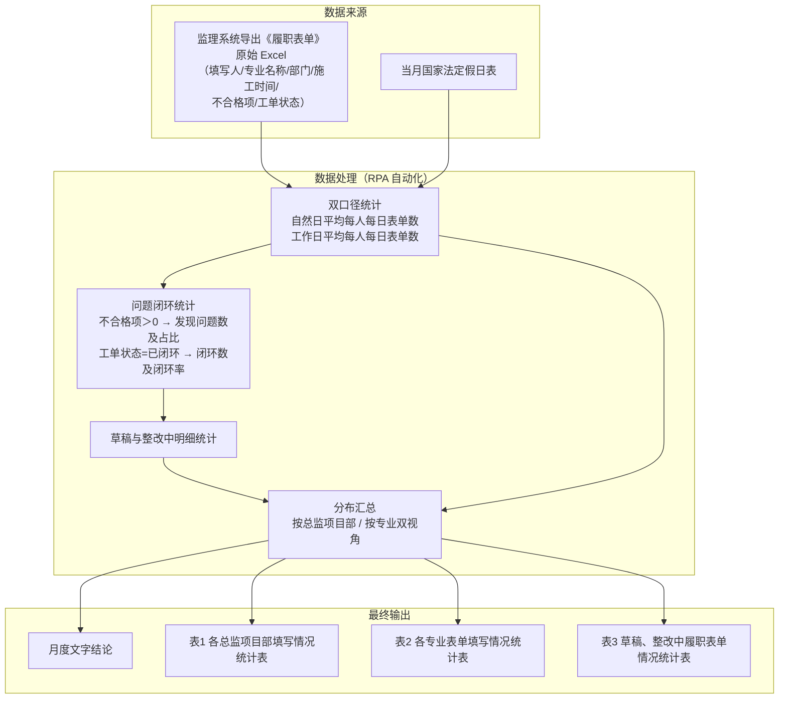

# 三份文档补图实施方案（已执行完毕）

> 更新时间：2026-09-07 18:45
> 依据：`需要补图的地方.md`（人工标注，2026-09-07 18:36 同步版）+ 三份 docx 实际锚点扫描 + 仓库上下文基线
> **分工现状：图片生成已由 agent 全过程自动执行完毕（无需人工介入）；人工仅需按下表将图片插入文档对应位置。**

---

## 一、生成方式执行记录（真实 GUI 截图优先原则的核验结论）

按"真实 GUI 截图优先、伪界面兜底"原则，先对 6 个模块逐一核验源码（基线 + 8 程序清单）：

| 模块 | 真实 GUI 核验结果 | 执行方式 |
|------|-------------------|----------|
| 在途单据监控周报/月报（科技中心） | 无对应 GUI；科创部真实 GUI 仅有"日报数据处理"（STID，另一模块） | **伪界面**，克隆操作手册已嵌"在途单据监控日报"真实截图的 MainWindow 风格 |
| 次日计划统计（咨询部） | 无对应 GUI；咨询部真实 GUI 属"第三方管控表工具"（CTSD，另一模块） | **伪界面**，克隆 2.1 节已嵌 CTSD 真实截图风格 |
| 履职表单自查指引 / 工分统计 / 履职表单抽查情况（监理部） | 无对应 GUI（feng/zeng 真实 GUI 属工作计划统计等模块） | **伪界面**，克隆 5.1 节已嵌 SVPD 真实截图风格 |
| 序时账处理（财务部，王工） | `FinanceDepartment/wang/2/` 有序时账处理逻辑（按"凭证编号"合并、按"会计期间/科目编号"筛选排序），但其 GUI 为通用 Excel 筛选/排序对话框，**无专用序时账操作界面**（2026-09-09 补核验） | **伪界面**，克隆 CTSD/SVPD 风格（同王工具箱 UI 体系），含"开始运行 + 程序启动"双按钮 |

结论：6 个模块均无自身可运行 GUI，全部按第二优先级走**伪界面**；风格基准直接取自操作手册中已嵌入的 4 张真实 GUI 截图（经 editor_sdk 提取比对），保证与已插图模块观感一致。生成工具：tkinter 还原布局 + PrintWindow 自动截图（脚本存档 `_temp/gen_pseudo_gui.py`，可随时改字段重新生成）。

## 二、图片资产清单（✅ 已全部生成，位于 `A-docs/插图/`）

| 资产文件 | 参考尺寸 | 风格基准 | 质检 |
|----------|-----------|----------|------|
| `插图-在途单据监控周报-伪界面.png` | 约 420×690 | MainWindow（日报） | ✅ 目测通过 |
| `插图-在途单据监控月报-伪界面.png` | 约 420×690 | MainWindow（日报） | ✅ 目测通过 |
| `插图-次日计划统计-伪界面.png` | 约 880×550 | CTSD（2.1 节） | ✅ 目测通过 |
| `插图-履职表单自查指引-伪界面.png` | 约 880×640 | SVPD（5.1 节） | ✅ 目测通过 |
| `插图-工分统计-伪界面.png` | 约 880×640 | SVPD（5.1 节） | ✅ 目测通过 |
| `插图-履职表单抽查情况-伪界面.png` | 约 880×640 | SVPD（5.1 节） | ✅ 目测通过 |
| `插图-图6-履职表单抽查情况需求分析图.png` | 1800px 宽 | mermaid 默认主题 | ✅ 目测通过 |
| `插图-序时账处理-伪界面.png`（2026-09-09 补） | 约 1080×520 | CTSD/SVPD（王工具箱） | ✅ 目测通过 |

## 三、人工插入对照表（唯一需要人工做的步骤）

> 操作方式：Word 中按"锚点定位"列查找占位文字 → 删除占位段 → 插入对应 PNG（嵌入型、居中）→ 保留图题行。

### 3.1 RPA软件操作手册（7 处）

| # | 锚点定位（占位文字所在图题） | 插入图片 |
|---|------------------------------|----------|
| 1 | "图：在途单据监控周报功能操作界面"上方的`（截图待插入）` | `插图-在途单据监控周报-伪界面.png` |
| 2 | "图：在途单据监控月报功能操作界面"上方的`（截图待插入）` | `插图-在途单据监控月报-伪界面.png` |
| 3 | "图：次日计划统计功能操作界面"上方的`（截图待插入）` | `插图-次日计划统计-伪界面.png` |
| 4 | "图：序时账处理功能操作界面"（**无占位文字**：在标题"3.1 序时账处理自动化流程"与该图题之间插入图片） | `插图-序时账处理-伪界面.png` |
| 5 | "图：履职表单自查指引功能操作界面"上方的`（截图待插入）` | `插图-履职表单自查指引-伪界面.png` |
| 6 | "图：工分统计功能操作界面"上方的`（截图待插入）` | `插图-工分统计-伪界面.png` |
| 7 | "图：履职表单抽查情况功能操作界面"上方的`（截图待插入）` | `插图-履职表单抽查情况-伪界面.png` |

### 3.2 RPA项目需求规格说明书（1 处）

| # | 锚点定位 | 插入图片 |
|---|----------|----------|
| 8 | 6.8 节`（补充图片）`占位段（其下为图题"图6 监理部监理业务履职表单抽查情况需求分析图"） | `插图-图6-履职表单抽查情况需求分析图.png` |

图6 采用 mermaid flowchart 绘制，沿用既有图1~图7"数据来源→数据处理→最终输出"三段式结构；mermaid 源码备份如下（如需调整后重渲染）：

### 3.3 RPA软件方案设计（3 处，与操作手册共用图）

| # | 锚点定位 | 插入图片 |
|---|----------|----------|
| 9 | 3.5.5 履职表单自查指引（冯工）→（1）界面展示下的`（界面截图待插入）` | `插图-履职表单自查指引-伪界面.png`（同 #5） |
| 10 | 3.5.6 工分统计（王工）→（1）界面展示下的`（界面截图待插入）` | `插图-工分统计-伪界面.png`（同 #6） |
| 11 | 3.5.7 履职表单抽查情况（曾工）→（1）界面展示下的`（界面截图待插入）` | `插图-履职表单抽查情况-伪界面.png`（同 #7） |

> 备注：人工备注原第 1 条"每周工程安全检查问题台账"已于 2026-09-07 18:36 同步为"工分统计（王工）"，与文档实际锚点（3.5.6）一致，差异消除。

## 四、插入后收尾建议

1. 插入完成后核对：科技中心两图与已插图"在途单据监控日报"风格一致；监理部三图与已插图 5.1/5.2 一致；图6 编号与既有图1~图7 连续。
2. 全部插入并校对后，可归档或删除 `需要补图的地方.md` 与本方案文档。
3. 若需调整任一伪界面字段/文案：编辑 `_temp/gen_pseudo_gui.py` 对应模块配置后重跑，同名覆盖。
